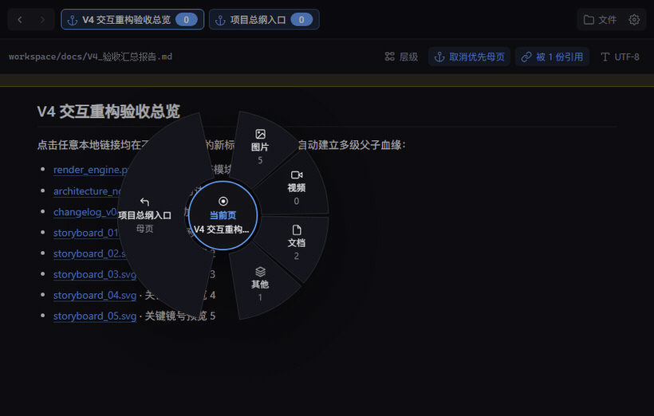
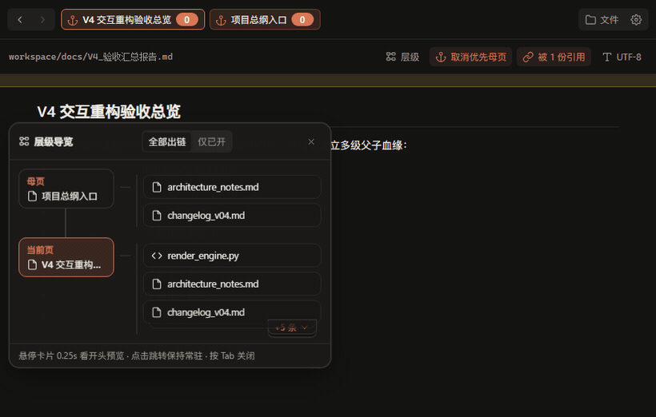
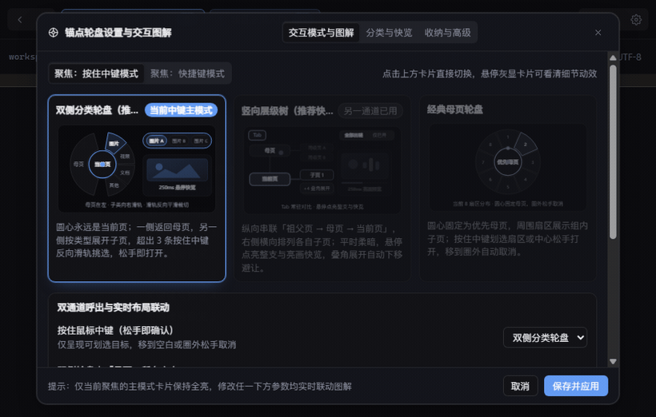

<div align="center">


# 锚点轮盘 · AnchorWheel (`agy-anchor-wheel`)

**专为 Google Antigravity 右侧文档栏打造的零侵入导航与阅读增强插件**

不覆盖原 MD 打开子链接 · 按住中键双侧分类轮盘 · 按 `Tab` 呼出竖向层级树 · 0.25s 悬停快览 · Obsidian 双向反链 · 多编码自动防乱码

</div>

---

## 为什么需要 AnchorWheel？

AI 对话总结出一份含十几个参考文件的 Markdown 报告时，在 Antigravity 原生右侧边栏逐一查阅常常碰壁：

- **点击链接覆盖原页**：在 MD 里点开子文件会直接顶替当前汇总页，来回切回去非常繁琐。
- **标签栏瞬间挤爆**：文件一多，侧栏顶部的标签立刻挤成一团，横向翻找根本分不清哪份是主干。
- **双向脉络缺失**：看某个脚本或截图时，很难知道它在哪几份 AI 总结报告里被引用过。
- **中文旧文档乱码**：打开 `GBK` / `GB18030` / `Shift-JIS` / `UTF-16` 文本或双击中文路径链接时容易报错或乱码。

**AnchorWheel** 在**完全不修改 Antigravity 客户端安装包任何文件（Zero-ASAR）**的前提下，用「**原生侧栏无感增强 + 独立官方工作台**」双模架构彻底解决这些问题。

---

## 核心交互演示

### 1. 按住鼠标中键：当前页双侧分类轮盘与反向跟手滑轨



- **以当前页为圆心**：圆心永远锚定当前阅读文档；一侧半环直接返回**母页**（支持设为左 / 上 / 右 / 下任意方向），另一侧按自定义文件分类（图片 / 视频 / 文档 / 兜底「其他」）展开当前页子项。
- **纯净松手确认**：按住中键呼出时，画面绝不堆砌点不到的多余按钮——划到母页或具体子页松手立即打开，移到空白处或圈外松手直接取消。
- **无限列表反向跟手滑轨**：单类子页超过 3 条时折叠在末尾滑轨；按住中键沿着滑轨方向移动光标，内部子页会反向按比例平滑滚动，手指停下即定格在光标正下方（贴近屏幕右边缘时自动镜像向左展开，绝不裁切）。

---

### 2. 按 `Tab` 键：竖向层级树与 0.25 秒防黑帧快览



- **安全覆盖右侧栏原生 `Tab`**：在右侧文档区按 `Tab`，直接呼出/关闭层级导览，彻底解决原生按 `Tab` 突然跳回页首的打断感；在聊天输入框、搜索框和代码编辑器内自动放行原生 `Tab`。
- **常驻不挡滚轮、连续对比跳转**：浮层开启时，光标移到窗外照常滚轮翻阅原文档且浮层保持不关；左键点击任意节点跳转后默认保持常驻并实时刷新树状结构，直到再按一次 `Tab` 或 `Esc` 关闭。
- **纵向血缘 × 叠角展开**：左侧竖列串联「祖父页 → 母页 → 当前页」，右侧分别展示同级兄弟与当前子页（默认合并「已开子标签 + 本文出链」，顶部可一键切为「仅已开」）；平时柔暗低干扰，光标移入整支点亮并亮起引导线；超过 3 条时在末尾叠出折叠折角，点击展开后下方条目平滑向下让位。
- **0.25 秒极速快览**：光标停在任意子卡片 0.25 秒即弹出轻量预览卡——文档仅截前 8KB（自带 GBK/UTF-16 解码），大图自动压制轻量缩略图，视频自动跳过片头黑帧抽取首段画面并在后台异步缓存 3 秒压缩动态 WebP。

---

### 3. 设置中心与三态实时联动交互图解



- **严格单主亮三态对比卡片**：任意时刻仅当前选中的主交互卡片全亮显示，其余模式卡片自动退为柔和灰显；悬停任一灰显卡片立刻过渡到清晰预览态查看动效细节，点击即可直接切换模式。
- **全参数零延迟实时驱动动画**：调节「母页所在方向」「自定义分类规则」「快捷键」「经典轮盘扇区数（4 / 6 / 8）」「子页范围」「快览延迟」或「四套主题」时，上方示意图解毫秒级同步旋转、增减扇区并刷新亮暗演示。

---

## 更多实用能力

- **不覆盖原页与拖拽新建**：左键点击 MD 内链接默认新开标签（`Alt + 左键` 原位替换）；中键点击链接静默收入分组；直接把 MD 链接拖拽到顶栏新建标签，或拖进「优先母页」数字徽章折叠收纳。
- **优先母页分组 + LRU 自动清理**：可将任意汇总 MD 设为优先母页（含 3 个以上本地链接时自动立组），超出设定上限时自动按最近最少访问清理未加锁旧标签，并保留在「最近收纳」中随时一键捞回；全局支持后退 / 前进与滚动位置还原。
- **Obsidian 风格双向反链 & 自动防乱码**：增量索引工作区、Antigravity 会话报告及自定义 Obsidian 仓库；原生支持 `UTF-8`、`GB18030 / GBK`、`UTF-16`、`Shift-JIS`、`Big5` 识别与原位重解码转换（转换自动生成 `.bak.encoding` 备份）。
- **与 `obsidian-prism` 光学审美零冲突共存**：所有自建节点均带独立防碰撞标识，无缝跟随深空黑曜、暖炭玄岩、白昼冷晶、暖白画册四套配色。

---

## 3 步快速安装

仅需本机已安装 **Node.js `>= 22`**（纯原生实现，零第三方 npm 依赖）。可选安装 `ffmpeg` 以解锁长视频 3 秒动态预览缓存，未安装也可流畅使用其它全部功能。

1. 克隆仓库并进入目录：

```bash
git clone https://github.com/Curelove/agy-anchor-wheel.git
cd agy-anchor-wheel
```

2. 一键备份并安装到本地 Antigravity 插件目录：

```bash
npm run install:plugin
```

3. 打开或切换至 Antigravity：
   - **原生右侧栏无感增强（推荐）**：当 Antigravity 开启调试端口启动（`--remote-debugging-port=0`，如已安装 `obsidian-prism` 或使用设置内生成的调试启动器）时自动附着生效。
   - **独立 Sidecar 工作台**：在 Antigravity 侧栏右上角 `+` 菜单中直接打开「**锚点轮盘工作台**」，免调试端口亦可开箱即用。

### 运行测试与卸载还原

```bash
# 运行完整单元测试与无头浏览器集成测试
npm test

# 完全卸载插件
npm run remove:plugin

# 卸载代码但保留个人设置与历史分组数据
node scripts/remove-plugin.mjs --keep-data
```

---

## 仓库目录结构

- `sidecars/anchor_wheel/backend/`：后端 HTTP/RPC 路由、多级父子血缘与 LRU 状态存储、双向反链索引、8KB 防黑帧快览引擎及编码探测修复模块
- `sidecars/anchor_wheel/shared/`：双端共享的双侧分类轮盘、经典母页轮盘、竖向层级树、三态联动设置图解引擎及光学 Token 样式表
- `sidecars/anchor_wheel/native/`：Zero-ASAR 原生右侧栏伴生增强注入脚本
- `sidecars/anchor_wheel/frontend/`：独立 Sidecar `AUX_PANE` 侧栏工作台页面
- `scripts/`：带滚动备份与 `data/` 保留保护的安装 / 卸载脚本
- `tests/`：单元测试、API 集成测试、无头浏览器 DOM 测试与多视口视觉审计脚本

---

## 开源协议

基于 [MIT License](./LICENSE) 开源，欢迎提 Issue 或 PR 交流改进建议。
